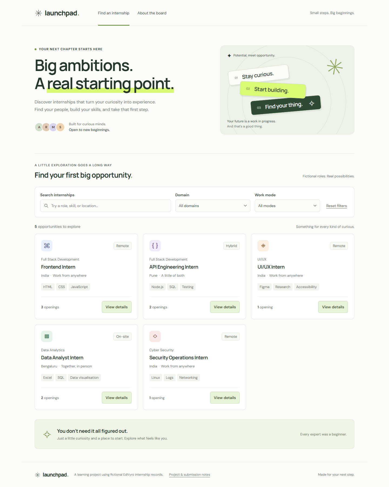
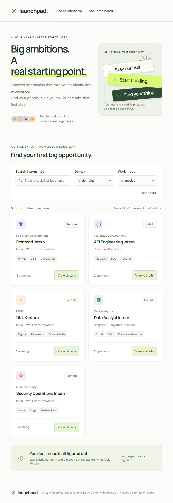
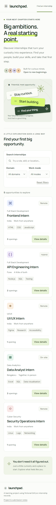

# Launchpad · Responsive Internship Board

A beginner-friendly internship board built with semantic HTML, responsive CSS, and vanilla JavaScript. Search the supplied fictional roles by title, skill, domain, location, or work mode; combine domain and work-mode filters, then open an accessible detail dialog.

## Preview and submission

The deployed preview URL will be recorded here after deployment. The preview includes a **Project & submission notes** page with the screenshots and explanation, so it can serve as one proof link. A public GitHub repository still needs an authenticated GitHub connection.

## Run locally

Requires Node.js 20+:

```sh
npm install
npm start
```

Open `http://127.0.0.1:4173`. The site is buildless: deploy the `dist/` directory to any static host. Serve over HTTP rather than opening `index.html` directly because records are loaded with `fetch()`.

## Page plan and implementation

1. Header with navigation and skip link.
2. Introductory hero describing the board.
3. Labelled search and domain/work-mode filters.
4. Live result count, semantic list of reusable internship cards, and loading/empty/error states.
5. Native detail dialog with keyboard dismissal and focus restoration.
6. About note, footer, and supporting project page.

The supplied JSON retains all five IDs and all original fields. `board.js` validates the records and filters them with AND logic. `app.js` renders cards with DOM APIs and `textContent`, avoiding insertion of data as HTML. Search matches all entered words without case sensitivity. Domain options come from the dataset. Failures include retry; resetting or clearing filters restores all records. No personal data or credentials are collected.

## Verification

```sh
npm test
```

Browser tests use an installed Chrome at the Windows path in `playwright.config.js`. On another system, remove `launchOptions.executablePath` and run `npx playwright install chromium` first. Screenshots are regenerated by the viewport tests.

Coverage: seed IDs, case/whitespace and skill search, combined filters, malformed/duplicate data, empty data, empty-state reset, request failure/retry, loading, dialog Enter/Escape and focus restoration, JavaScript errors, and horizontal overflow at 360px, 768px, and 1440px. See [QA evidence](docs/qa.md).

## Screenshots

Desktop · 1440px



Tablet · 768px



Mobile · 360px



## Accessibility

Native controls provide Tab/Shift+Tab navigation. Visible focus outlines, a skip link, explicit form labels, a polite live count, an error alert, and `aria-busy` convey state. Each card has its own heading and an individually named detail button. Native `dialog.showModal()` contains focus, supports Escape, and restores focus to the trigger. Reduced-motion preferences disable animation. Layout uses one, two, or three columns and avoids horizontal scrolling at the required widths. Automated checks do not replace a full screen-reader audit.

## Supplied materials and scope

- [Printable task guide](https://edvyro.in/datasets/task-kits/full-stack-development-task-1.html)
- [Editable checklist](docs/checklist.md)
- [Internship product brief](https://edvyro.in/datasets/source-materials/task-source-library.html#full-stack)
- [Original seed JSON](https://edvyro.in/datasets/source-materials/internship-records-sample.json)

This implements the task-specific, framework-free frontend checklist, plus the source brief's work-mode filtering and details. The broader source-library brief also describes a server API, pagination envelope, application submissions, server validation, duplicate prevention, database seeding, and a two-minute walkthrough. Those production features are outside this frontend submission and are **not implemented**. There are no API keys, database, environment variables, application forms, or real internship applications. Records are fetched from the original static JSON envelope `{ "internships": [...] }`. The supplied downloads are retained in `docs/` for reference.

## Publish to GitHub

After connecting GitHub, create a public repository and push this project. For GitHub Pages choose **GitHub Actions** in repository Settings → Pages; the included workflow deploys `dist/`. Use the public repository URL as the single submission link, with its preview URL and screenshots in this README. The connected Sites source repository is managed hosting storage and is not a public GitHub repository.
